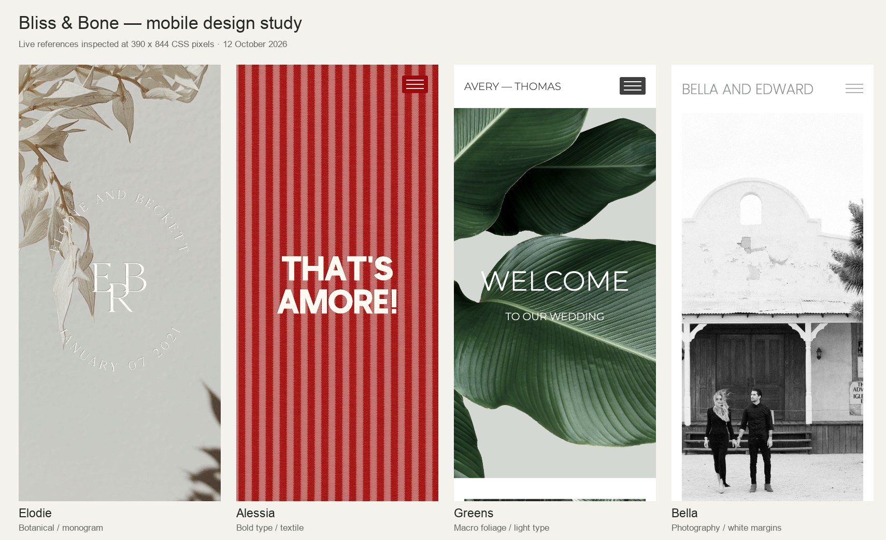

# Bliss & Bone — live design study

Inspected on **2026-10-12**, Asia/Tashkent, following the user's request to
understand the website designs and effects for future Invitation Studio work.
This is a research deliverable and implementation brief. The proposed recipes
and components below have not been added to the renderer or generation prompt.

## Evidence and scope

Inspected the catalog, five live templates, their served CSS and interaction
scripts, desktop and mobile layouts, menu opening, an FAQ disclosure and page
navigation. Explicit browser viewports were **1440×900** and **390×844** CSS px.
The marketing preview embeds the actual website in an HTML `object`; the live
documents below were inspected directly rather than judging catalog thumbnails.

- [Elodie live](https://myblissandbone.com/elodie) · [catalog preview](https://blissandbone.com/wedding-website/preview/elodie-wedding-website)
- [Alessia live](https://myblissandbone.com/alessia) · [catalog preview](https://blissandbone.com/wedding-website/preview/alessia)
- [Greens live](https://myblissandbone.com/greens) · [catalog preview](https://blissandbone.com/wedding-website/preview/greens-wedding-website)
- [Bella live](https://myblissandbone.com/bella) · [catalog preview](https://blissandbone.com/wedding-website/preview/bella-wedding-website)
- [Plunge 01 live](https://myblissandbone.com/plunge-01) · [catalog preview](https://blissandbone.com/wedding-website/preview/plunge-01-wedding-website)

[Measurements](./measurements.json) contain computed styles. Declared font
families are not a universal independent font-file audit. In particular,
Elodie's cover identity is an embedded SVG graphic: its surrounding `h1` font
size does not measure the lettering inside it. Motion durations below describe
source declarations, not recorded end-to-end timings; background tabs can
throttle timers. Reference screenshots are study evidence only, never runtime
artwork. No RSVP was submitted and no account or subscription was created.

## What gives each design its identity

| Template | Observed composition | Reusable principle |
|---|---|---|
| Elodie | Full-screen botanical photograph with large cast shadows and a circular SVG monogram; earth-coloured wedding panel; serif headings and widely tracked metadata | Treat the opening as a designed stationery composition. Follow a rich image with a quiet, high-contrast information panel. |
| Alessia | Scarlet textile stripes, oversized cream grotesque, script identity in the header, alternating cream/pink panels and a split menu | Commit to one graphic motif, one dominant colour and a strong display face. Bold wedding design need not use gold or floral borders. |
| Greens | Macro foliage fills image panels; light sans lettering overlays leaves; white content areas provide pauses | One well-cropped image can supply depth, texture and the entire colour vocabulary. |
| Bella | Black-and-white couple photography inside white margins; small left-aligned identity; content separated into navigable pages | Let photography set the emotional tone and use the frame, margins and quiet type to support it. |
| Plunge 01 | Graphic cover identity, large destination image panels and narrow itinerary columns | Give a wedding weekend a coherent visual identity while separating practical content into readable groups. |

These are different visual systems, rather than the same composition with
different colours. The contrast between display and factual text, the image
scale and the sequence of surfaces all matter.

## Measured type and responsive behaviour

| Element | 1440px desktop | 390px mobile |
|---|---:|---:|
| Elodie section heading, Cormorant Garamond Light | 75px / 97.5px leading | 52.5px / 68.25px |
| Elodie event metadata, EB Garamond Regular | 13px / 16.9px; 5px tracking | Same; extra line wrapping |
| Alessia cover heading, Olivie Sans | 151px / 151px | About 64px / 64px; two lines |
| Alessia content heading | 66px / 66px | 46.2px / 46.2px |
| Greens image heading, Montserrat Light | 75px / 97.5px | 52.5px / 68.25px |
| Greens supporting heading | 20px / 26px | 20px / 26px |
| Plunge itinerary image heading, Poppins Light | 45px / 58.5px | 31.5px / 40.95px |

Many headings use a 70% mobile scale. Typical heading columns contract from
700px to 350px; header side padding contracts from 40px to 20px. Secondary
content may have another inset, leaving a 310px column. Cover images use
`background-size: cover`; their visible content consequently changes with aspect
ratio. Bella's mobile crop retains the couple while removing much of the scene.

Their editor exposes independent mobile image focal points and a no-crop option
for suitable content images. This is deliberate image direction, beyond making
the page narrower. [Mobile tools](https://blissandbone.com/help-center/website-mobile-tools),
[section design](https://blissandbone.com/help-center/website-section-design).

For our Russian and Uzbek invitations, preserve hierarchy rather than literal
tracking or sizes. Elodie's 13px metadata with 5px tracking is not a good default
for long Cyrillic details. Use locale-verified display faces, readable factual
copy and the existing protected crop/resolution rules.

## Effects: what was actually verified

The sampled live sites load jQuery and legacy GSAP TweenLite/CSSPlugin. The
marketing catalog separately loads GSAP 3 and ScrollTrigger; those libraries on
the catalog do not prove the templates use scroll-triggered animation.

| Interaction | Verified mechanism | Translation to our stack |
|---|---|---|
| Alessia menu | Full-screen split overlay; links become active in sequence, with a 200ms scheduled start and 100ms steps; link opacity transitions are 400ms | An accessible dialog, CSS opacity/transform transitions or Motion stagger. Preserve focus and Escape behaviour. |
| Menu icon | Hamburger bars rotate into a close mark | Animate two pseudo-elements with transform. |
| Menu hover | Underline expands from the left using `scaleX`; 400ms transition | CSS pseudo-element; also provide a visible keyboard focus state. |
| Cover/header relationship | After the cover threshold, Elodie/Alessia switch header classes and show the smaller identity on a light header | Observe the cover boundary; keep a stable header height. |
| Internal anchor navigation | TweenLite scrolls to the target over 600ms with a 200ms delay and Power3 easing | Native anchors with reduced-motion-aware smooth scrolling; custom timing only if the composition needs it. |
| Bella page navigation | Existing sections switch visibility, old section fades out over 400ms, next fades in with jQuery's `fast` setting, and history/hash updates | Optional route/content transition using Motion; maintain real navigation and back-button behaviour. |
| Alessia FAQ | Answer starts hidden; clicking toggles the open state and slides the answer over 400ms | Prefer semantic `details`/`summary`; animate only if it improves the experience. |

In a controlled Elodie scroll of 200px, the background layer moved upward by
200px, retained its background position and had no transform. Its depth comes
from the photograph and shadows. Parallax was not verified in these examples;
neither were particles, animated 3D scenes or cover videos. The five inspected
documents had no `video` element. Official website section documentation
describes external video embeds and currently excludes cover-page video and
autoplay. Do not confuse the separate digital-invitation product's motion
claims with a website template's observed capabilities.
[Video and section rules](https://blissandbone.com/help-center/website-section-design).

## How the sites are assembled

Bliss & Bone's documented editor combines global font/colour roles, a header
and menu, and ordered sections. Section text can sit below an image, entirely
on it, or have only its heading on the image. Section styles determine the
layout; some adjacent matching sections form image columns. Logos and monograms
are separate uploaded graphics. This supports our existing architectural choice:
hand-built components with structured design data.
[Design settings](https://blissandbone.com/help-center/website-design-settings),
[section formats](https://blissandbone.com/help-center/website-section-design).

## Original recipes for Invitation Studio

These are proposed art directions, **not new registered preset IDs**.

1. **Botanical stationery.** One original botanical photograph or illustration,
   a restrained cast-shadow layer, expressive serif names and an original
   monogram. Alternate a visual opening, solid event panel and paper story
   spread. Keep names/date as HTML. Start from `ceremony` or `editorial` type.
2. **Bold celebration.** One scarlet, cobalt or other brief-led accent, a
   locally authored stripe/textile motif and monumental grotesque names.
   Alternate graphic and neutral panels. Start from the locale-safe `modernist`
   set, and keep metallic finishing off unless requested.
3. **Photo editorial.** Supplied photography, substantial white/paper margins,
   one strong opening crop and quieter supporting typography. Use the existing
   `editorial-story`/`keepsake` structures when a story is appropriate. Give each
   photo its own role and render it once.

Recommended first sequence: identity opening → short invitation → date/calendar
→ venue image or art panel → itinerary → dress palette → RSVP → small identity
footer. Omit empty optional sections. Use actual event facts, supplied photos
and original artwork. Our initial screen should make the names and date clear
even when a decorative monogram is present.

## Implementation priorities mapped to the current code

| Priority | Needed work | Existing foundation |
|---|---|---|
| 1 | Three genuinely different art directions, each with its own typography, image role and section rhythm | `lib/ai/prompts/generateSeries.ts`, type-set registry, `WeddingStory.tsx` and `ScrollNarrative.tsx` |
| 1 | Explicit per-section visual treatments: paper, solid colour, image panel, framed photo; validate foreground contrast for each | `theme` schema, `toCssVars`, narrative slots and surface primitives |
| 1 | Mobile focal points and appropriate image roles for each composition | `DirectedImage.tsx`, asset direction and protected crop rules |
| 2 | Optional compact navigation, original monogram placement and restrained link feedback | `InvitationExperience.tsx`, `Hero.tsx` and native section anchors |
| 2 | Optional FAQ using real host-provided answers | Would require a content/schema section and renderer component; not currently part of the eight-section contract |
| 3 | Additional section/route transitions only when a design needs them | Existing `motion` dependency; no second animation library is needed |

We already have an envelope entrance, 850ms section reveals, a 950ms clipped
title reveal, calendar actions and restrained pointer interaction. The main
gap exposed by this study is **composition and section-level art direction**.
Adding more animation without changing these would leave the designs too alike.

Implementation acceptance: inspect 390/1024/1440px, long Cyrillic names, Uzbek
glyphs, image crop protection, readable image-overlay text, keyboard navigation,
reduced motion, no-JS content, stable layout and meaningful RSVP behaviour.
Keep original imagery/fonts appropriately licensed; screenshots here are not
assets to ship. No application tests were needed for this documentation-only
change.
