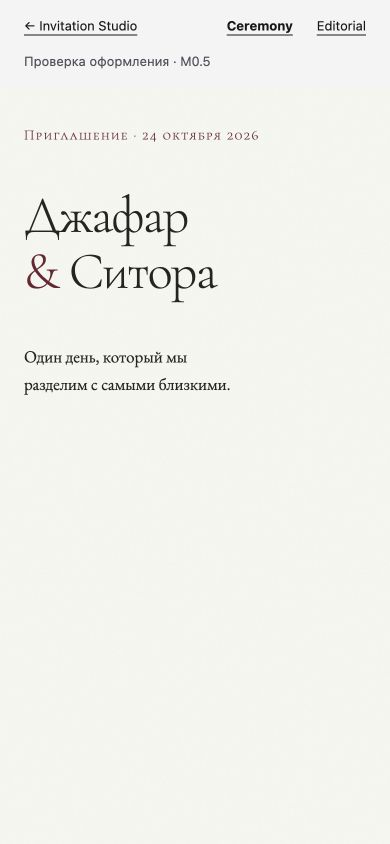
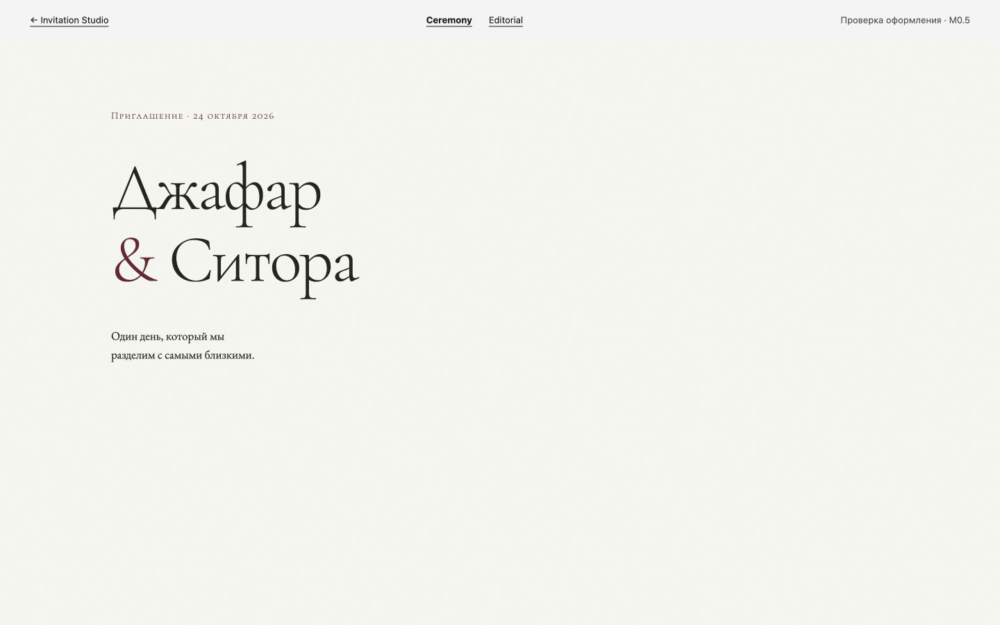

# M0.5 craft verification — 2026-10-09

Verified the production build with the in-app Chromium browser at
`http://127.0.0.1:3147/craft`. This is a craft specimen; the invitation template
and M1's three design critique loops remain a separate milestone.

| Actual CSS viewport | Ceremony display | Editorial display | Horizontal overflow |
|---|---:|---:|---|
| 390×844 | 52 px | 49.68 px | none in either |
| 1024×768 | 95.68 px | 84 px | none in either |
| 1440×900 | 96 px | 84 px | none in either |

Both choices load just two font preloads: the selected display's Latin and
Cyrillic subsets at weight 300 or 600. Body faces are not preloaded. Computed
styles use the prepared families, real caps features and the expected weights.
The WOFF2 tests independently verify glyph shaping, file hashes and metrics.

On mobile, the two below-fold blocks start pending and become shown on scroll;
the three initial blocks remain shown. The Uzbek passage retains U+02BB and
U+02BC and has `lang="uz-Latn"`; root language is `ru`. Keyboard Tab focuses
Editorial with a 2px current-colour outline and 3px offset; Enter switches the
pair. Browser console reports no warnings or errors.

No-JS behavior is checked by server-rendering `Reveal`: text is present, there
is no ready attribute, and every opacity-zero CSS rule requires that attribute.
This is an SSR/CSS regression check, not a browser run with JavaScript disabled.
Reduced-motion rules remove transitions, delays and animations; live preference
emulation was not available in this browser tool. Platform-specific fallback
wrapping is still limited by the installed system font versions.

Validation: **101 tests passed**, ESLint passed, TypeScript passed, production
build passed. No runtime dependency was added for font preparation. Font assets
total 536,748 bytes across 21 subsets; unused weights do not load on demand.

