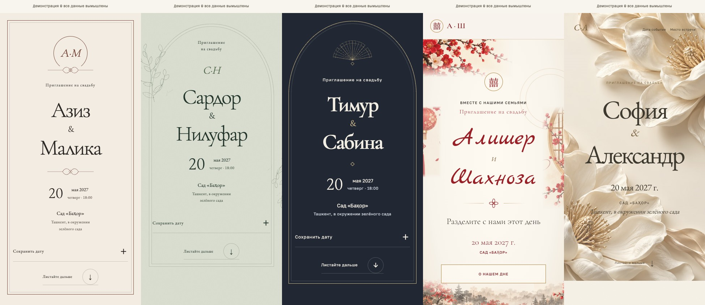
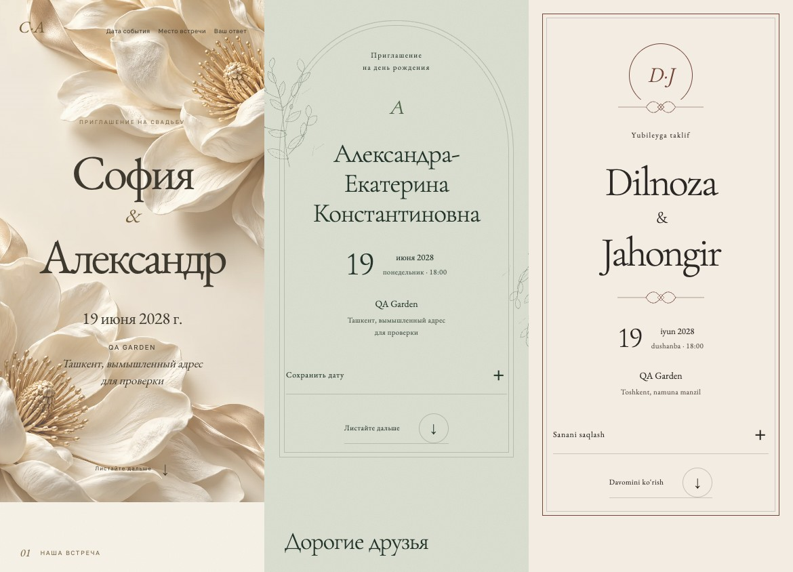

# Локальная проверка продукта — 22 октября 2026

> Исторический отчёт до расширения AI-мастера. Описанные ниже ограничения одной свадебной коллекцией больше не отражают текущую версию; актуальные возможности и незавершённая приёмка новых дизайнов описаны в [локальном плане](../README.md).

Цель: проверить готовые сайты, работу гостевых действий и качество мобильной
вёрстки. Все аккаунты, имена и события в этом прогоне вымышлены. Проверки
выполнялись с отдельным временным хранилищем, без изменения существующих проектов.

## Результат

- `npm test`: **66 файлов, 583 теста прошли** после исправлений.
- `npm run lint`: успешно.
- `npm run typecheck -- --incremental false`: успешно до исправлений;
  финальная сборка также выполнила проверку TypeScript и ESLint успешно.
- `INVITATION_BUILD_DIR=.next-local-quality-final npm run build`: успешно.
- `scripts/qa-local-product.mjs`: **30 из 30 комбинаций страниц и размеров**,
  без ошибок JavaScript, горизонтального overflow, дублирующихся видимых ID,
  сломанных загруженных изображений и ссылок на отсутствующие разделы.
- Проверены пять шаблонов на **320/390/430/1280 px**, узбекская версия
  Sculpted Garden и три опубликованных сценария на **320/390/430 px**.
  Узкие размеры используют mobile/touch-контекст Chromium.
- Для свадьбы, дня рождения и годовщины проверены сохранение и повторное чтение,
  публикация, изоляция опубликованного снимка от правок черновика, запись и
  изменение RSVP. Отключённые данные дня рождения отсутствуют и в публичном
  JSON, и в полном HTML собранного приложения.
- Настоящая браузерная отправка формы **без JavaScript** вернула `303`, открыла
  подтверждение и сохранила ответ. Проверен фактический `Origin` отправленного
  запроса; запросы с чужим Origin по-прежнему получают `403 INVALID_ORIGIN`.
- **Новых платных AI-вызовов: 0.** Этот прогон проверяет подготовленные шаблоны
  и работу продукта. Он не доказывает качество новых генераций по разным брифам.
- `git diff --check`: успешно.

Машинный результат: [report.json](report.json).

## Найдено и исправлено

### Длинное имя разбивалось посреди слова

В Botanical имя «Александра-Екатерина Константиновна» занимало слишком крупный
кегль, а аварийный `overflow-wrap: anywhere` разрывал отчество. Общий renderer
теперь использует более компактную типографику для длинных имён. Короткие имена
сохраняют прежнюю подачу. Браузерная регрессия проверяет строковые прямоугольники
слова «Константиновна»: на 320/390/430 px оно целиком помещается на одной строке.

Изменены `components/layouts/StudioTemplateInvitation.tsx` и
`app/studio-templates.css`.

- [До исправления, 390 px](published-birthday-390-hero-before.png)
- [После исправления, 390 px](published-birthday-390-hero.png)

### Нативная форма RSVP получала отказ

Проверка настоящим браузером обнаружила `Origin: null` и
`403 INVALID_ORIGIN` при отправке без JavaScript. Причина — метаданные гостевой
страницы `referrer: no-referrer`. В `app/i/[slug]/page.tsx` установлено
`same-origin`: форма сохраняет доказательство своего origin, адрес приглашения
не передаётся внешним сайтам. Общая проверка CSRF не ослаблена. Прежний HTTP smoke
с явно заданным Origin сам по себе этот браузерный случай не проверял.

### Граница dev-проверок

Первый запуск против dev-сервера обнаружил скрытые вымышленные поля в
диагностической сериализации HTML, хотя публичный API их уже исключал.
Финальная проверка полного публичного HTML выполнена на локальной собранной
версии через `next start`; исключения для этих полей в QA не добавлялись.
Dev-сервер предназначен для доверенной локальной разработки.

## Визуальный просмотр

Просмотрены мобильные обложки пяти шаблонов и разделы опубликованных тестовых
страниц: основной экран, середина страницы, формы и завершение. Свадебный
Sculpted Garden проверен в настоящем mobile/touch-контексте. Имя в тестовом
дне рождения после исправления читается без разрыва отчества; страницы сохраняют
общие цвета, типографику и оформление нижних разделов.

## Что осталось для продуктовой цели

AI-мастер по-прежнему ограничен свадьбой и одной коллекцией Sculpted Garden.
Чтобы студия создавала разные поздравительные сайты, следующая работа должна
дать ему выбор композиции и типографики из существующего реестра, учитывать
категорию события и поддержать поздравление без мероприятия. Эти функции
данным прогоном не реализованы. План приёмки по пяти разным брифам находится
в [описании локального этапа](../README.md).

Качество анимации, Safari, физическое устройство, скорость загрузки и
соответствие новых AI-результатов разным брифам требуют отдельных проверок.
Замечания об очень маленьких элементах и скрытых accessibility-заголовках в
JSON — кандидаты для ручной оценки, а не автоматическая оценка красоты.
