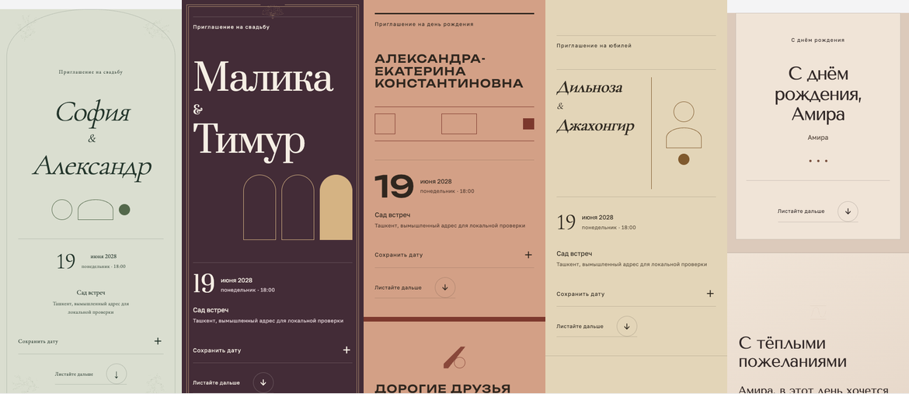

# Локальная приёмка ИИ-студии · 23 октября 2026

Результат: **PASS в описанных локальных границах**. Студия создаёт редактируемые
приглашения и личные поздравительные сайты. Расширены выбор композиции, шрифтов,
палитры и декора, мастер создания, редактор и история оформления. Личное
поздравление не требует мероприятия и не содержит календаря или RSVP.

## Подтверждённые результаты

| Проверка | Результат | Доказательство |
| --- | --- | --- |
| Реальные генерации после исправления planner summary | 5/5, по одному planner-вызову, 0 image-вызовов на результат | [Исходный отчёт](../designs-live/report.json); callAttempts также сверены с приватной записью задач |
| Повторная проверка этих же публикаций | 20/20, 320/390/430/1280 px; без новой генерации | [Отчёт](../designs-reviewed/README.md) |
| Пять заранее заданных композиций | 20/20 browser; API: факты, сохранение, публикация и восстановление оформления | [Отчёт](../fixtures-reviewed/README.md) |
| Мастер → редактор → сохранение → повторное открытие | 2/2 сценария, AI-ответ подменён; 0 запросов к провайдеру | [Отчёт](../wizard-reviewed/README.md) |
| Регрессия прежних шаблонов и RSVP | 30/30; нативная форма без JS сохранена | [JSON](../baseline-regression/report.json) |
| Личное поздравление без JS | 3/3 ширины; читаемый текст, без действий мероприятия | [JSON](../designs-reviewed/no-javascript.json) |
| Unit/integration suite | 69 файлов, 605 тестов | `npm test` |
| Статические проверки и сборка | PASS | `npm run lint`, `INVITATION_BUILD_DIR=.next-platform-designs-accepted npm run build` (включает TypeScript) |

Пять результатов используют четыре семейства, пять разных первых сцен и пять
шрифтовых пар. Заданные имена, даты, место, программа и существующие тексты
сохранены. В личном поздравлении headline/greeting/closing до запроса были
пустыми и заполнены моделью. Восстановление оформления сохраняет более поздние
правки фактов; черновик не меняет опубликованный снимок.

До успешной серии пять запросов завершились ошибкой: модель вернула слишком
длинное служебное summary. [Первый отчёт](../designs-live/initial-failure-report.json)
сохранён. После одного дополнительного диагностического planner-вызова исправлен
промпт и ограничено только служебное summary; публичные тексты не обрезаются.
Ещё одна ошибка запуска fixture-скрипта была вызвана обращением к старому серверу
4312; актуальная приёмка выполнена на 4314. Повторные browser-прогоны не запускали AI.

## Просмотр оформления

Просмотрены обложки и полные мобильные страницы всех пяти реальных результатов.
Ботаническая свадьба сохраняет светлый шалфейный ритм и тонкий декор; вечерний
вариант — тёмную рамку и геометрию; день рождения — плотную плакатную типографику
и карточки программы; годовщина — журнальное разделение и широкие поля; личное
поздравление — спокойную карточку и отдельные пожелания без гостевой формы.
Фотографий в этих брифах не было: портреты и пустые фотозаглушки не добавлены.

Исправлены разрывы длинного отчества в широком гротеске и заголовков в узких
колонках. Размер учитывает метрики выбранного шрифта, регистр и фактическую
ширину колонки через CSS container units. Проверка использует диапазоны текста
в браузере: отсутствие общего overflow само по себе не скрывает разрыв слова.
Шрифты проверяются по реально используемому семейству и глифам.



[Полные страницы рядом](../designs-reviewed/full-pages-overview.png).
Художественная оценка здесь качественная; она не является измерением или
гарантией качества любого будущего запроса.

## Готовые локальные примеры

- [Ботаническая свадьба](http://127.0.0.1:4314/i/invite-1576e70411fc3fb41e2066a8)
- [Вечерняя свадьба](http://127.0.0.1:4314/i/invite-d3701c109ea9ec2ecb16dae0)
- [День рождения](http://127.0.0.1:4314/i/invite-f30d9eb6d76e62694e4c5d2d)
- [Годовщина](http://127.0.0.1:4314/i/invite-da4d51962d1c4298f9066e96)
- [Личное поздравление](http://127.0.0.1:4314/i/invite-7ac98c6925685a8c008da91c)
- [Студия для создания своего сайта](http://127.0.0.1:4314/dashboard)

Все данные вымышленные. Изолированный набор QA сохранён в игнорируемой Git
директории `.platform-data/design-acceptance-2026-10-23`, отдельно от прежних
локальных проектов. После копирования проверено равенство всех пяти публикаций.
Для следующего локального запуска из корня репозитория:

```sh
INVITATION_BUILD_DIR=.next-platform-designs-accepted \
PLATFORM_DATA_DIR="$PWD/.platform-data/design-acceptance-2026-10-23" \
PLATFORM_AI_DAILY_LIMIT=5 \
npm run start -- --hostname 127.0.0.1 --port 4314
```

## Границы

Chromium с эмуляцией touch и reduced motion; Safari, физический телефон и обычная
анимация не проверены. Эта live-серия не проверяет корпоративный повод, помолвку,
категорию «другое», новую загрузку фото/visual references или новое Sculpted
Garden artwork. Эти ветки покрыты схемами/тестами в разной степени, но успешная
генерация в данной серии их не подтверждает. Пожелания требуют смыслового
просмотра автором.

Работа остаётся локальной: файловое хранилище, один Node-процесс. Генерация
выполняется в HTTP-запросе и автоматически не возобновляется после перезапуска.
Общий лимит медиа учитывает прежние изображения и референсы; очистка хранилища
остаётся отдельной задачей. Публичное размещение и платежи не входили в этап.
