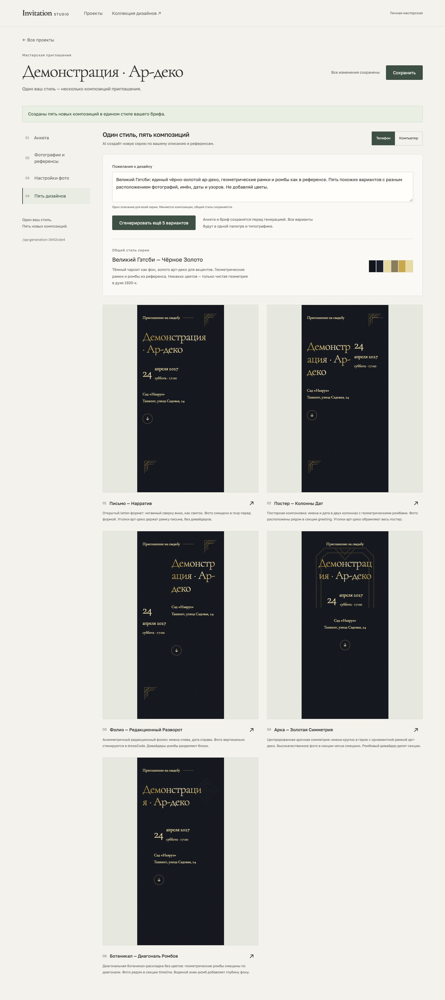

# Coherent design generation — 2026-10-10

The user's revised acceptance is implemented: one brief produces five new
related compositions in the same visual style. New projects start empty,
and copied legacy demonstration themes are hidden from the generated grid.
The separate read-only collection still shows the hand-authored examples.

The studio saves pending questionnaire and brief edits before calling the real
Anthropic SDK. One forced tool response selects a common palette, typography,
material, artwork, foil, ornament language and motion, then five composition
configurations. The renderer remains handwritten. `art-deco` adds a stepped
frame, corners, diamonds and divider suitable for Gatsby briefs. Reference
images inform the common style and are not placed as event photographs.

Generation varies section ordering, ornament positions, photo sections,
before/after positions and row/stack/offset arrangements. Every enabled photo
must appear exactly once in every variant. Its protected crop, filter and
viewport limit remain controlled by the saved asset plan. Photos still marked
unused are excluded. Unsaved photo settings must be saved before generation.
If a generated full-photo snapshot later loses its eligible hero photo, its
display becomes typographic while the original file stays immutable. This
keeps the project editable and regenerable without inventing replacement media.

Shared palette repair runs once; every composition then passes schema, registry,
locale, contrast and photo checks. There is at most one correction retry.
Missing credentials, malformed responses and provider errors never return
demo designs. Failed regeneration preserves the last successful series.
Content, plan and generation revisions are checked both before the call and
under the project lock before persistence. Immutable batch files become
visible only after the atomic generation.json pointer commit. In-progress
initial batch directories are ignored by readers.

## Verification

- Unit/transport/store tests: **153 passing**. These cover shared styles,
  contrast repair, exact photo ids, prohibited hero quality, protected crops,
  one bounded retry, missing/invalid credentials, empty creation, stale writes,
  immutable batch retention and removal of a generated hero photo.
- Type checking, lint and optimized production build pass.
- A real call on the user's Gatsby brief produced five cohesive compositions
  in **28.1 seconds** using `claude-sonnet-4-6`; reload preserved the batch.
  User facts, images, keys and screenshots are not committed.
- Two real fictional acceptance runs took **33.2 and 67.0 seconds** with two
  enabled photos and one geometric reference. The latest report is
  [qa.json](./qa.json). This is a real provider run, not a canned API response.
- Browser checks cover empty initial state, brief autosave, five rendered
  previews, shared style, varying photo placement, modal/Escape, reload,
  320/390/768/1440px studio widths and all five invitations at 320/1440px.
  Photos decode, retain the shared monochrome treatment and whole protected
  area; the small source remains capped. Long headlines fit the viewport.
- A controlled failing regeneration preserves the visible grid and generation
  manifest. Three separate stale revisions return 409 before provider work.
- Updated questionnaire/upload and manual photo regression scripts also pass.
  Their archived M2/M3 reports remain historical; fresh runs were written to
  temporary directories. Photo regression explicitly installs its own legacy
  theme fixtures, never a production creation fallback.

The fixture uses the public-domain NASA Apollo 11 photograph documented in
[M3 fixture provenance](../m3/README.md), a downscaled copy and an original
geometric reference drawn only for testing. Event facts are fictional.
The script removes only its own UUID-named test project.



## Repeat the live acceptance

Run against a started production server with a configured key. The explicit
flag authorizes one generation request (plus one correction if necessary).
Playwright and Chrome paths can be supplied from an existing runtime without
adding a production dependency:

```sh
STUDIO_QA_LIVE=1 \
STUDIO_PLAYWRIGHT_MODULE=/absolute/path/to/playwright/index.mjs \
STUDIO_CHROME=/absolute/path/to/chrome \
node scripts/qa-generation.mjs
```

`STUDIO_QA_URL` overrides the default `http://127.0.0.1:3147`;
`STUDIO_QA_OUTPUT` redirects screenshots/report output. The same output
override is available for qa-studio.mjs and qa-photos.mjs.

## Remaining scope

This generates renderer configurations from registered elements and existing
artwork. It does not draw new bitmap assets for every brief. Material choices
currently use the implemented paper preset with dark or light palettes; two
measured type sets and four ornament packs are available. History selection,
approval/refinement and publishing remain later milestones. Old batch files
are retained but not yet selectable in the studio. Provider timing varies;
the original 45-second M4 target is not guaranteed. Real M3 face/quality
inference still requires its separate mixed-camera acceptance batch.
