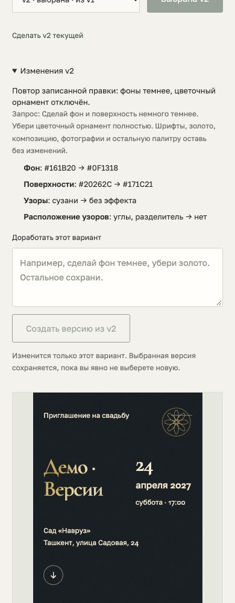

# M5 — selection, partial refinement and version history

The studio now supports choosing one generated version, making a plain-language
edit to one concept, browsing its history and restoring an earlier current
preview. These are separate pointers: creating or restoring a version never
changes the chosen version automatically. Even a new batch retains the previous
selection and its preview link.

`POST /api/refine` receives the concept/source version, instruction and content,
plan and generation revisions. A real Anthropic structured tool emits a strict
partial theme patch. Objects merge by key, arrays replace, and unmentioned
fields preserve their values. Metadata, event facts, arbitrary CSS and protected
crops are excluded. Empty/unsupported patches return an explanation; malformed
patches get at most one correction retry. No alternate design is fabricated.
The merged candidate must pass the existing renderer, locale, contrast, photo
and populated-section checks. Necessary safety repairs are explicitly recorded.

Every new theme and provenance file is immutable. The concept's next version
number is greater than every existing one, even when editing an earlier source.
Atomic links publish complete files without overwriting; the generation pointer
commits last. Stale requests fail under the project lock. Selection uses a
separate atomically replaced approved.json with its own revision. Restoration
changes the current preview pointer only. Legacy generated files without
provenance load with their available version history.

Under each card, the user can select a version to preview, make it current,
choose it explicitly, or enter an edit. History shows the instruction and real
before/after changes with Russian labels. Existing content/photo edits must be
saved before choosing or refining, so the reviewed preview uses saved data.
Provider failure retains the old versions, selection and typed instruction.

## Verification

- **166 unit/transport/store tests pass**, with type checking, lint and optimized
  production build. New cases cover exact partial edits, array replacement,
  absent defaults, strict field allowlists, invalid/unsupported provider output,
  one correction retry, source/selection immutability, branching, pointer restore,
  simultaneous edits and stale selection/plan/generation revisions.
- A real `claude-sonnet-4-6` call took **4.35 seconds** and changed exactly
  `palette.bg`, `palette.surface`, `ornament.pack`, `ornament.placement` for
  “make both backgrounds darker and remove floral ornaments”. Typography, foil,
  layout, remaining palette, metadata and photos were unchanged. No safety
  repair was needed. See [qa.json](./qa.json).
- Production browser acceptance selects v1, creates v2, verifies original and
  selection files byte-for-byte, previews/restores v1, explicitly chooses v2,
  reloads, and checks both pointers and all history entries.
- A controlled failed provider response preserves files and the entered text.
  Stale refinement/approval revisions return 409 and missing restore versions
  return 404 before mutation.
- 320/390/768/1440px studio checks pass without horizontal overflow. The initial
  long selection-preview link overflowed on a narrow screen; wrapping and its
  width cap were fixed, then the acceptance passed.
- The baseline is explicitly controlled test data: five related hand-prepared
  configs over a fictional event, not AI-generated output. Refinement itself
  uses the real provider. Only the script's own UUID-named project is mutated
  and deleted. No user's selection, designs or private facts were modified.
- Final Russian change labels and screenshots were checked using a recorded
  replay of that same verified partial patch, without another provider call.
  [qa-ui.json](./qa-ui.json) explicitly identifies this UI replay; qa.json
  remains the independent live-provider acceptance report.



## Repeat the acceptance

Start the built server with ANTHROPIC_API_KEY configured. The opt-in flag
authorizes a real refinement request, with at most one correction retry:

```sh
STUDIO_QA_LIVE=1 \
STUDIO_PLAYWRIGHT_MODULE=/absolute/path/to/playwright/index.mjs \
STUDIO_CHROME=/absolute/path/to/chrome \
node scripts/qa-refinement.mjs
```

STUDIO_QA_URL and STUDIO_QA_OUTPUT override the default server URL and output
directory. No production dependency or test-only generation/refinement API is
installed. The controlled baseline is created only in the script's own project.
For UI-only iteration after a live acceptance, `STUDIO_QA_RECORDED=1` replays
the recorded changes into another isolated test project, writes qa-ui.json
and captures screenshots without calling the provider. This mode does not
claim to retest the live refinement transport.

## Remaining scope

Choosing a version records a local decision; public publication is M7. Full
M6 visual-QA checks/badges are not yet an approval gate. Older selected batches
can be previewed, while history/restore edits the active five lineages. A full
previous-batch browser is not implemented. Refinement works with registered
presets; arbitrary numeric spacing, new fonts and bitmap generation are not
available through this API. Shared event facts and photo directions remain live
across theme versions, as in the existing preview architecture.
