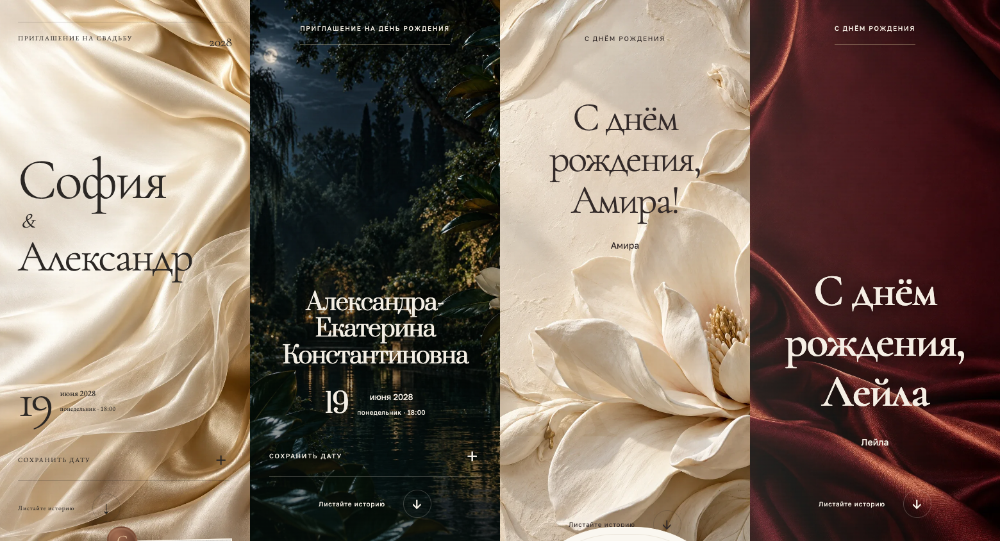

# Индивидуальные материальные сайты

Исправление читаемости личных поздравлений и контраста финала описано в
[отдельном отчёте](reading-fix.md). Актуальная локальная сборка —
`.next-material-reading-accepted`.

Прежние пять вариантов прошли функциональные проверки, но владелец отклонил их
визуально: плоские поверхности, однотипные разделы, недостаточно индивидуальности.
Этот этап меняет художественный подход, а не только цветовую схему.

Материальная концепция хранит собственное название, физическую сцену и
композицию сайта. ИИ по умолчанию планирует оригинальное изображение для
конкретного брифа. Шёлк, фарфор и ночной сад — разные материальные языки;
editorial, immersive и keepsake — независимые способы построить страницу.
Это текущие три структурных направления, а не гарантия безграничного набора
уникальных макетов. Общие библиотечные формы и интерфейсы переиспользуются.

Ориентиры: [Tilda Zero Block](https://help.tilda.cc/zero) — независимое
расположение элементов и адаптация для разных экранов;
[слои между блоками](https://blog-en.tilda.cc/zero-block-big-update).
Это принципы нашей реализации; функциональный паритет с Tilda не заявляется.

## Локальные примеры

| Сайт | Материал и построение | Ссылка |
| --- | --- | --- |
| София и Александр | Светлый шёлк, редакционная типографика, письмо с сургучом, бумажная сцена даты | [Открыть](http://127.0.0.1:4315/i/invite-758c987c942f036275f2c1a3) |
| День рождения | Ночной сад, дата над водой, арочное изображение у места, программа двумя колонками, встроенный RSVP | [Открыть](http://127.0.0.1:4315/i/invite-bcaf09fef10fa8ab5676cbca) |
| Поздравление Амире | Фарфоровый рельеф, арочное письмо поверх обложки, спокойный финал | [Открыть](http://127.0.0.1:4315/i/invite-d295acafb9165598f0b7a4e5) |
| Поздравление Лейле | Бордовый шёлк; новый фон и пожелания через реальный AI-поток приложения | [Открыть](http://127.0.0.1:4315/i/invite-26857eb74a12d833ff3ea320) |



Первые три сайта — авторские проверочные композиции с оригинальными фонами,
созданными встроенным `imagegen` и загруженными через обычный owned media API.
Композиции заданы явно для сравнения. Четвёртый сайт не использует эти фоны:
реальный planner выбрал `silk + immersive`, `wine`, `editorial`, затем сервис
создал новое изображение через провайдер и сохранил результат.

## Проверка

- [Три композиции](final/README.md): 13/13 страниц, 320/390/430/1280 px и
  поздравление без JavaScript; изображения, шрифты, переносы, якоря, overflow.
  Повторный прогон читал те же публикации без изменения данных и вызовов AI.
- API: 3/3 — owned material, сохранение, публикация, история
  `artDirection + artwork`, сохранение поздних правок текста и изоляция
  опубликованной версии. [Исходные доказательства](acceptance/report.json).
  Первые ложные ошибки headline из-за NBSP устранены нормализацией пробелов
  в проверке; приватный заголовок управления намеренно заменяется именами.
- [Редактор](editor-acceptance/README.md): настоящий select меняет композицию,
  iframe обновляется, autosave/reopen сохраняют выбор и исходное изображение;
  первоначальный layout возвращён. Генератор не вызывался.
- [Реальный AI-запрос](live/report.json): один успешный POST без повторов;
  новое owned artwork, имя и отсутствие мероприятия сохранены, пустые поля
  поздравления заполнены. [Просмотр результата](live/browser.json): 5/5 страниц,
  включая no-JS, без новых генераций. Пожелания требуют смыслового просмотра.
- 71 файл / 621 тест, ESLint, TypeScript и production build
  `.next-material-studio-release` прошли.
- [Независимый просмотр полного скролла](final/visual-review.md): исходное
  сходство середины silk/night существенно уменьшено. Общими остаются отдельные
  dress-code и RSVP-компоненты.

## Реализация и материалы

`MaterialSceneInvitation.tsx` и `material-studio.css` задают живые обложки,
семантические главы, фотографии целиком и существующую форму RSVP.
`lib/platform/art-direction.ts`, platform schemas/history и platform AI
сохраняют концепцию, права на изображение и восстановление оформления.
В редакторе доступны композиция, шрифты и версии. Материал/свет/фон меняются
новым описанием; готовое изображение не перекрашивается палитрой.

Материальная генерация требует planner и image provider, расходует один
image-вызов. Явно запрошенный дизайн без изображений сохраняет native-путь.
Ошибка сохраняет текущий сайт; незавершённый материальный проект нельзя
опубликовать. Новое изображение создаётся для каждого материального запроса.

[Точные промпты и файлы встроенного imagegen](image-prompts.json):
[silk.webp](../../public/artwork/material-studio/silk.webp),
[porcelain.webp](../../public/artwork/material-studio/porcelain.webp),
[night-garden.webp](../../public/artwork/material-studio/night-garden.webp).
Целые изображения 1024×1536 перекодированы в WebP без обрезки.

Сервер 4315 использует отдельное игнорируемое Git хранилище
`.platform-data/material-studio-2026-10-23`. После остановки можно запустить:

```sh
INVITATION_BUILD_DIR=.next-material-reading-accepted \
PLATFORM_DATA_DIR="$PWD/.platform-data/material-studio-2026-10-23" \
npm run start -- --hostname 127.0.0.1 --port 4315
```

Все данные вымышленные; внешней публикации не было. Safari, физический телефон,
обычные анимации и производственная инфраструктура не проверены. Один успешный
запрос не доказывает качество всех будущих брифов. Готовый сайт оценивается по
полному скроллу, а не только по обложке и зелёным тестам.
